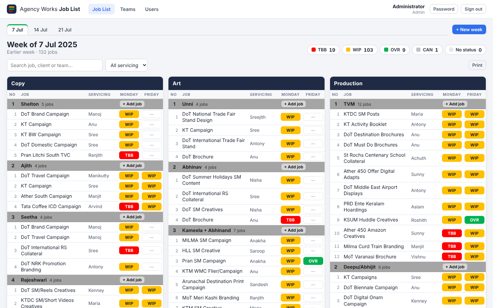

# Agency Works · Job List

A digital version of the weekly **Agency Works** joblist spreadsheet. It's a live tracker for every job in
**Copy**, **Art** and **Production**, with the same layout and colour-coded statuses as the sheet.



## How it maps to the spreadsheet

| Spreadsheet | App |
|---|---|
| A sheet tab per week (`7 July`, `14 July`, …) | Week tabs at the top of the board |
| Copy / Art / Production column groups | Three department columns |
| Grey header rows (Shelton, Unni, TVM, Video …) | **Teams**: one block per person, pair or unit |
| No · Job · Servicing · Monday Status · Friday Status | Same columns; statuses are click-to-change |
| Cell colours | TBB red · WIP amber · OVR green · CAN grey |
| Copying the sheet for the next week | **+ New week** carries over every job not marked OVR/CAN |

## Roles

| Role | Can do |
|---|---|
| **Admin** | Everything: users, teams, weeks and all jobs |
| **Department head** | Start new weeks, and add, edit, move or delete jobs and manage teams in their own department |
| **Team member** | Add jobs to their own team and update the Monday/Friday status of their team's jobs |

Everyone can see the whole board. Every change is recorded in the job's **History**.

## Running it

Requires **Node.js 22.13+**. The app uses Node's built-in SQLite, so there's no database server to install.

```bash
npm install
npm run build
npm start            # http://localhost:3001
```

For development, run `npm run dev`. The API runs on :3001 and Vite with hot reload runs on http://localhost:5173.

On first start the database (`data/joblist.db`) is seeded from `server/seed/joblist.json`. That file holds the
July 2025 sheets imported from the original Excel file. Seeded logins:

| Username | Password | Role |
|---|---|---|
| `admin` | `admin123` | Admin |
| `copy.head`, `art.head`, `production.head` | `welcome123` | Department heads |
| one per team, e.g. `shelton`, `unni`, `tvm`, `video`, `gayathri.anna` | `welcome123` | Team members |

**Change these passwords before real use.** Set `ADMIN_PASSWORD` / `SEED_PASSWORD` before the first start, or change
them in the app under *Password* and *Users*. Run `npm run seed` to wipe the database and re-seed it.

### Environment variables

| Variable | Default | Purpose |
|---|---|---|
| `PORT` | `3001` | HTTP port |
| `DATA_DIR` | `./data` | Where the SQLite database lives |
| `JWT_SECRET` | generated into `DATA_DIR` | Session signing key |
| `ADMIN_PASSWORD` / `SEED_PASSWORD` | `admin123` / `welcome123` | Initial passwords (first seed only) |
| `INSECURE_COOKIE` | unset | Set to `1` to serve production over plain HTTP |

### Re-importing from Excel

```bash
python3 scripts/import_xlsx.py "Agency_Works_July_2025.xlsx" server/seed/joblist.json 2025-07-07
```

## Project layout

```
server/   Express API (auth, permissions, jobs, weeks, teams, users), SQLite schema, seeding
client/   React (Vite) front end: login, board, teams, users
scripts/  Excel → JSON importer
```
